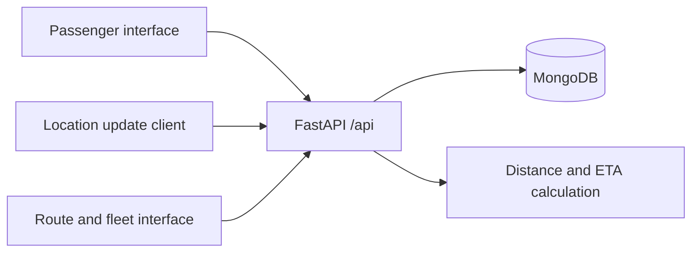

# NIGHTRIDERS

A bus-tracking prototype with a React/Leaflet interface and a FastAPI/MongoDB backend. It models routes, live vehicle coordinates, and estimated arrival times.

## Architecture



`backend/server.py` contains the API, data models, and Haversine distance calculation. `frontend/src/App.js` connects the browser to the backend. This is a prototype: route labels such as `/admin` do not establish authorization by themselves.

## Local setup

Use a dedicated development MongoDB database and a Python environment. Backend dependencies are declared in `backend/requirements.txt`.

```bash
cd backend
python -m venv .venv
source .venv/bin/activate
pip install -r requirements.txt
cp .env.example .env
uvicorn server:app --reload --host 127.0.0.1 --port 8000
```

In another terminal:

```bash
cd frontend
npm install
REACT_APP_BACKEND_URL=http://localhost:8000 npm start
```

The frontend expects the backend origin; it appends the `/api` prefix. Configuration is embedded by the React build. MongoDB must be running before exercising storage endpoints. The backend reads its `.env` from the backend directory. These setup commands document the current source contract; a clean end-to-end deployment has not yet been verified.

## API workflows

Explore generated request models at <http://localhost:8000/docs>.

| Endpoint | Purpose |
| --- | --- |
| `GET /api/routes/search` | Search route information |
| `GET /api/buses/live` | Read vehicle locations |
| `POST /api/buses/update-location` | Submit coordinates |
| `GET /api/eta/{bus_id}` | Calculate estimated arrival information |
| `/api/admin/routes` | Route management |
| `/api/admin/buses` | Fleet management |

## Engineering priorities

Before deploying to public users, add enforced authorization for fleet administration and location writes, coordinate validation, location freshness rules, authenticated driver identities, and abuse controls. Treat ETA as an estimate rather than a service guarantee; distance alone does not model traffic, dwell times, or schedule adherence.

Next verification work should cover invalid GPS inputs, missing vehicles, stale updates, route lookup, and API permissions. Frontend build success alone cannot verify these contracts. Existing test reports are historical artifacts and should be checked against the current commit.

The PDF in this repository provides project context. Current source, API schemas, and reproducible tests should remain the authoritative reference for behavior.
